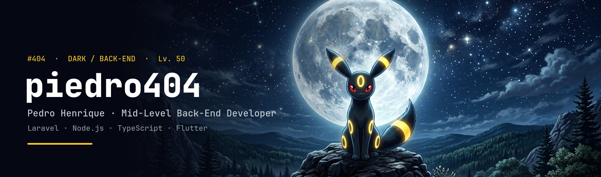
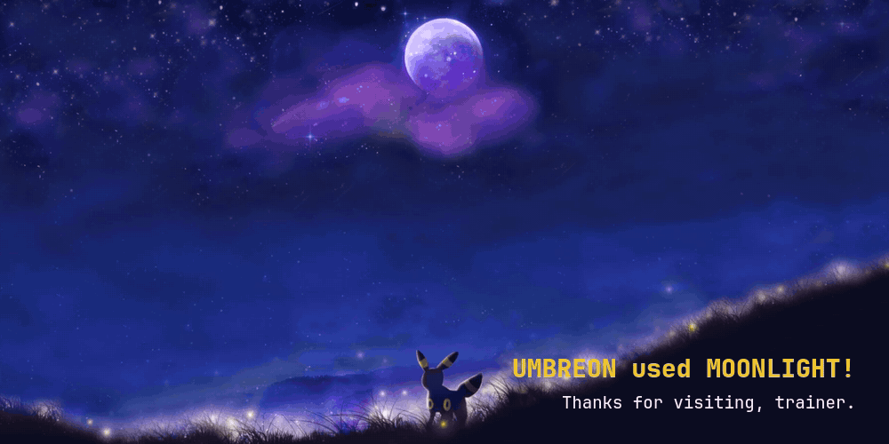

<!-- ============================================================
     🌙  piedro404 — Dark-type Back-End Developer
     Theme: Umbreon (#197) · night #050812 · ring #F5C518 · eyes #E3263B
     Sprites: PokeAPI/sprites · Type icons: duiker101/pokemon-type-svg-icons
     Pokémon © Nintendo / Game Freak / The Pokémon Company — fan tribute.
     ============================================================ -->

  

  

  
  
  

 

  

##  Pokédex entry

<table>
  <tr>
    <td width="150" align="center">
      
      
       <b>No. 404 · PIEDRO</b> 
      
    </td>
    <td>
      <b>PIEDRO</b>, <i>the Back-End Pokémon.</i> Found in Maranhão, Brazil. Most active at night, when production is quiet and bottlenecks are easy to spot.
        
      &#9656; <b>Mid-Level (Pleno) Back-End Developer at <a href="https://github.com/vokere-app">Eurekia</a></b>, building <b>Vokerê</b> (delivery) and <b>Educria</b> (AI-powered education) 
      &#9656; Led the migration of the legacy API to a layered architecture: <i>controller / repository / service, DTOs, providers, gateways, async jobs</i> 
      &#9656; Supports squad leadership: reviews and approves PRs, shapes tasks and presents progress to the CTOs 
      &#9656; Into <b>Software Architecture</b>, <b>Domain-Driven Design</b> and <b>scalable systems</b> 
      &#9656; B.Sc. Information Systems (<b>Unibalsas</b>) · IT Technician (<b>IFMA</b>)
    </td>
  </tr>
</table>

##  Signature moves

<table>
  <tr>
    <td width="33%" valign="top">
       
      <h3>Async Job</h3>
      POWER <b>100×</b> &nbsp;·&nbsp; ACC <b>100</b>
      
Instrumented a slow endpoint step by step with <code>microtime()</code>, found a synchronous HTTP call inside the request cycle and moved it into a queued job.

      
<code>10 s → 100 ms</code> <i>It's super effective!</i>

    </td>
    <td width="33%" valign="top">
       
      <h3>Evolve API</h3>
      POWER <b>2×</b> &nbsp;·&nbsp; PP <b>1/1</b>
      
Rebuilt the Vokerê API from a legacy codebase into a new architecture, owning critical modules like delivery control and third-party integrations.

      
<code>½ the resources</code> <i>The new API runs faster on half the infra!</i>

    </td>
    <td width="33%" valign="top">
       
      <h3>Brute Force</h3>
      POWER <b>ICPC</b> &nbsp;·&nbsp; PP <b>4/4</b>
      
Four straight years at the SBC Programming Marathon (ICPC), with an Honorable Mention every year and a spot in the Brazilian Finals.

      
<code>Finalist 2024</code> <i>A critical hit!</i>

    </td>
  </tr>
</table>

##  Eeveelution stack

One Eevee, many evolutions. Same with a good back-end dev.

<table align="center">
  <tr>
    <td align="center" width="33%">
       
       
      <b>Umbreon</b> → <b>Laravel · PHP</b> 
       
      The main. Night shift in production.
    </td>
    <td align="center" width="33%">
       
       
      <b>Jolteon</b> → <b>Node.js</b> 
       
      Non-blocking. Always strikes first.
    </td>
    <td align="center" width="33%">
       
       
      <b>Espeon</b> → <b>TypeScript</b> 
       
      Sees the bug before it happens.
    </td>
  </tr>
  <tr>
    <td align="center">
       
       
      <b>Glaceon</b> → <b>MySQL</b> 
       
      Keeps data frozen and consistent.
    </td>
    <td align="center">
       
       
      <b>Eevee</b> → <b>JavaScript</b> 
       
      The base form. Can evolve into anything.
    </td>
    <td align="center">
       
       
      <b>Leafeon</b> → <b>Python</b> 
       
      Where there's grass, there's a snake.
    </td>
  </tr>
  <tr>
    <td align="center">
       
       
      <b>Vaporeon</b> → <b>Docker</b> 
       
      Ships in containers. Whale-approved.
    </td>
    <td align="center">
       
       
      <b>Flareon</b> → <b>Firebase</b> 
       
      Real-time data, always hot.
    </td>
    <td align="center">
       
       
      <b>Sylveon</b> → <b>Flutter</b> 
       
      Pretty UIs on any screen.
    </td>
  </tr>
</table>

   <b>HELD ITEMS</b>  
  

##  My party

<table>
  <tr>
    <td width="50%" valign="top">
       <b><a href="https://github.com/piedro404/vecomigo-backend">VeComigo</a></b> 
       
      Node · TypeScript · Socket.IO · React
      
Real-time rooms over WebSockets: the server pushes events to every client in a room, no polling. Front and back deployed separately.

    </td>
    <td width="50%" valign="top">
       <b><a href="https://github.com/piedro404/bee-stats">Bee Stats</a></b> 
       
      Node · Express · Puppeteer
      
Scrapes a Beecrowd profile and serves it as a dynamic SVG card you can embed in any README.

    </td>
  </tr>
  <tr>
    <td width="50%" valign="top">
       <b><a href="https://github.com/piedro404/dino-neural-ts">Dino Neural</a></b> & <b><a href="https://github.com/piedro404/hide-and-seek-neural-ts">Hide & Seek Neural</a></b> 
        
      TypeScript · neural networks
      
Neural nets written from scratch in TypeScript, learning to play games: the runner dino and a hide-and-seek arena with agent vision.

    </td>
    <td width="50%" valign="top">
       <b><a href="https://github.com/piedro404/flask-structure">flask-structure</a></b> 
       
      Python · Flask · Swagger · <a href="https://pypi.org/project/flask-structure/">on PyPI</a>
      
A published Python package that scaffolds a ready-to-go Flask API structure in one command.

    </td>
  </tr>
  <tr>
    <td width="50%" valign="top">
       <b><a href="https://github.com/piedro404/ub-task-api">UB Task</a></b> (<a href="https://github.com/piedro404/ub-task-extension">extension</a> · <a href="https://github.com/piedro404/ub-tarefas-app">app</a>) 
       
      Python · Flask · JavaScript · TypeScript
      
An API + browser extension + app that fetch and organize Unibalsas coursework, so classmates never miss a deadline.

    </td>
    <td width="50%" valign="top">
       <b><a href="https://github.com/piedro404/organize-api-startup">Organize API</a></b> 
       
      Node · TypeScript · Prisma · Docker · JWT · Zod
      
Task and user management API with auth, validation and file storage on S3-compatible buckets.

    </td>
  </tr>
</table>

 Training ground: <a href="https://github.com/piedro404/resolucoes-de-problemas">resolucoes-de-problemas</a>, competitive-programming solutions (Beecrowd & Codeforces)

##  Evolution line

<table align="center">
  <tr>
    <td align="center" width="25%"> <b>2019</b> IT Technician at <b>IFMA</b>. The egg starts to move…</td>
    <td align="center" width="25%"> <b>2022</b> Information Systems at <b>Unibalsas</b>. First ICPC Honorable Mention.</td>
    <td align="center" width="25%"> <b>2024</b> Intern → Back-End Dev at <b>Vokerê / Eurekia</b>. ICPC Brazilian Finals.</td>
    <td align="center" width="25%"> <b>Now</b> <b>Mid-Level (Pleno)</b>: architecture, code review, squad support.</td>
  </tr>
</table>

<i>What? EEVEE is evolving! Eevee evolves into Umbreon when leveled up at night with high friendship. Turns out that's also how back-end devs are made: late nights and a great team.</i>

##  Badge case

<table>
  <tr>
    <td align="center" width="170"></td>
    <td><b>ICPC · SBC Programming Marathon, Brazilian Finals</b> 2024 Honorable Mention</td>
  </tr>
  <tr>
    <td align="center">   </td>
    <td><b>ICPC · SBC Programming Marathon, First Phase</b> 2022 · 2023 · 2024 · 2025 Honorable Mention, four years in a row</td>
  </tr>
  <tr>
    <td align="center"></td>
    <td><b>Programming Marathon, Phase Zero</b> Honorable Mention</td>
  </tr>
  <tr>
    <td align="center"></td>
    <td><b>TMs learned</b> NLW Unite (Node.js) · NLW Expert (Python) · Django 4.1 + Heroku deploy · SNCT 2021 (Big Data, computer evolution)</td>
  </tr>
</table>

##  Battle stats

  
  

  

  <picture>
    <source media="(prefers-color-scheme: dark)" srcset="https://raw.githubusercontent.com/piedro404/piedro404/output/umbreon-snake-dark.svg">
    <source media="(prefers-color-scheme: light)" srcset="https://raw.githubusercontent.com/piedro404/piedro404/output/umbreon-snake.svg">
    
  </picture>

 

  

  

